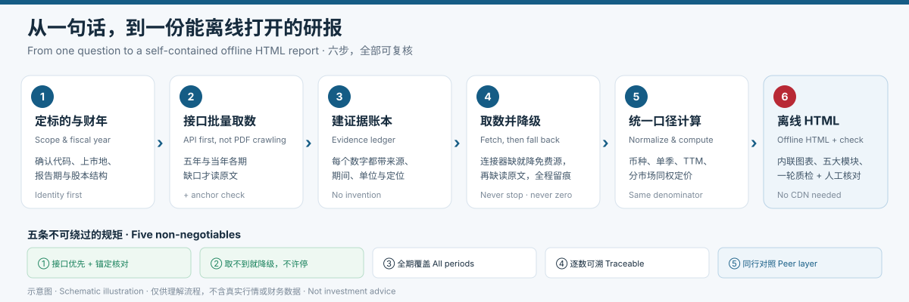
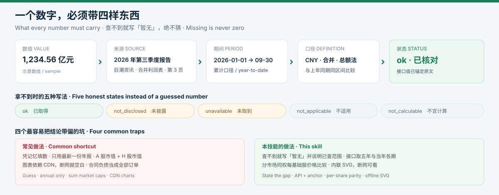

# 个股机构级基本面拆解 · Institutional Equity Deep-Dive

> 一个可安装的 AI Skill：把「帮我看看这家公司」变成一份**每个数字都有出处、能断网打开**的 HTML 深度研报。
>
> An installable AI skill that turns "analyze this stock" into an **offline HTML report where every number is traceable**.

[中文说明](#zh) · [English Guide](#en) · [SKILL.md](SKILL.md)



---

<a id="zh"></a>

## 中文说明

### 1. 这是什么？

它不是一段提示词，也不是一个聊天机器人。它是给 AI 助手看的**一套工作规范 + 一个计算脚本 + 一个检查脚本**。

装好之后，你只要说一句「用机构级基本面拆解分析 XXX」，助手就会按固定流程做研究，最后交给你**一个 HTML 文件**：双击就能打开，图表、表格、来源、解读都在里面，不需要联网。

一句话概括它管什么：**不许编数据、不许只看年报、不许把口径搅在一起**。

### 2. 为什么需要它？

| 常见做法 | 问题 | 本技能的做法 |
|---|---|---|
| 凭印象写财务数字 | 数字可能是旧的或错的 | 每个数字都写清「哪份报告、哪一页、什么期间」 |
| 只看最新一份年报 | 看不到当年已经发生的变化 | 五年年报 **＋ 当年已披露的每一份季报/中报** |
| A 股市值 + H 股市值 = 总市值 | 两地股本不同，加总是错的 | 分市场列价格与股本，同权才比价格折价 |
| 图表用在线 JS 库 | 断网 / 转发后一片空白 | 内联 SVG 或嵌入图片，单文件离线可看 |
| 毛利率一降就说「竞争恶化」 | 可能是并表、会计口径、低基数 | 先核合并范围与口径，再给有限度的判断 |



### 3. 你会拿到什么？

一个文件：`{代码}_{简称}_基本面深度拆解_YYYYMMDD.html`，里面有：

- **模块一** 主营穿透：分业务收入、毛利、客户与供应商集中度
- **模块二** 行业空间：中国 / 全球 TAM 与 CAGR，注明机构和口径
- **模块三** 同行池：国内 + 海外可比公司、商业模式、市占率
- **模块四** 七维诊断：一致预期、盈利质量、运营效率、债务、研发、分市场估值、筹码结构
- **模块五** 利率锚：3M / 10Y 美债、中国 10Y 国债、期限利差
- **末尾** 三条基于数字的结论、三条可被数字触发的风险、下一期跟踪看板、数据缺口清单

每个表格和图表后面都跟一段「基于本次数字的实用解读」，不是把表再念一遍。

### 4. 怎么安装？

**本仓库本身就是一个 skill**：`SKILL.md` 在根目录，其余文件都是相对路径，不依赖任何本机绝对路径。

**WorkBuddy（Windows 用户级）**

```bash
# 克隆后，把整个目录放到用户级 skills 目录，目录名与技能名保持一致
git clone https://github.com/098765d/Stock-Analysis.git institutional-equity-deepdive
# 然后复制到： C:\Users\<你的用户名>\.workbuddy-ai\skills\institutional-equity-deepdive\
```

**其他支持 `SKILL.md` 的 Agent**

按该 Agent 的文档，把本目录复制到它的 skills 目录即可。要求是：`SKILL.md` 在这一层，`references/`、`scripts/`、`assets/` 与它同级。脚本只用 Python 标准库，无需 `pip install`。

装好后可直接说：

```
用机构级基本面拆解分析 晶合集成 688249.SH
```

### 5. 它内部怎么跑？

1. **定边界** — 核实公司、代码、所有上市地、财年与分析日。
2. **读原文** — 打开并阅读五年年报 + 当年全部中期报告；同时清点当前助手已连接、且工具清单可读的数据连接器。
3. **建账本** — 每个原值记为一条带来源、期间、单位、定位的记录；缺失分「未披露 / 未取到 / 不适用 / 不宜计算」。
4. **算指标** — `scripts/calc_metrics.py` 做确定性计算：单季还原、TTM、周转天数、四单季三率、分市场估值、经验分位。
5. **出报告** — `assets/report-skeleton.html` 是离线版式模板，用实采数据填表和图。
6. **一轮检查** — `scripts/audit_evidence.py` 查证据结构、全期覆盖、离线资源；再由人核对原文与结论。

> 机器检查只保证结构自洽，**不能证明真的读过原文、清单没有遗漏、结论一定正确**。这一步必须人工过一遍。

### 6. 三条硬规矩

1. **原文优先**：财报数字以法定披露为准，数据连接器只用来加速和交叉验证。
2. **全期覆盖**：当年有一季报、中报、三季报就得三份都列，不能只挑最新一份。
3. **逐数可溯**：查不到就写「暂无公开数据 + 已查范围 + 原因」，绝不补 0、不外推。

### 7. 常见问题

**Q：必须装富途 / Wind 之类的连接器吗？**
A：不必须。技能每次会动态清点当前助手有什么工具；没有就走公开披露原文与权威网页。它不写死任何一家数据商。

**Q：会替我下单或给目标价吗？**
A：不会。只做研究与交付，不做交易、不访问个人账户、不自动发布；卖方目标价会标明是「别人预测」，并提示可能过时。

**Q：A+H 公司怎么算贵不贵？**
A：先把 H 股价格按注明日期的汇率折成人民币、换成每基础股价格，再和 A 股比；PE/PB/PS 用同一套全股本口径分别算。不会把两地市值相加。

**Q：为什么报告里看不到「边际毛利率」？**
A：这个指标在低基数、并表、一次性损益下会严重失真。改用最近四个完整单季的毛利率 / 营业利润率 / 净利率及环比，并显式检查合并范围。

**Q：能自己验证吗？**

```bash
python -B -m unittest discover -s scripts -p "test_*.py"     # 维护测试，只用合成数据
python scripts/calc_metrics.py --template                      # 查看输入结构
python scripts/audit_evidence.py input.json --html report.html # 生产证据与离线结构检查，0=通过
```

### 8. 目录结构

```
.
├── SKILL.md                    技能入口（name / description / 执行流程）
├── README.md                   本文件（中英双语）
├── .gitignore
├── docs/images/                本 README 的两张自制示意图
│   ├── overview.svg
│   └── evidence-chain.svg
├── references/                 六份方法规范（按需加载）
│   ├── data-governance.md      原文、全期覆盖、证据状态
│   ├── connector-discovery.md  动态连接器适配
│   ├── fallback-sources.md     公开原文与免费数据入口
│   ├── metric-formulas.md      公式与解释边界
│   ├── report-blueprint.md     报告结构与验收
│   └── input-schema.md         v3 证据账本字段
├── scripts/
│   ├── calc_metrics.py         确定性指标计算
│   ├── audit_evidence.py       证据 / 离线 HTML 检查
│   └── test_*.py               维护用回归测试（合成数据）
└── assets/report-skeleton.html 离线研报版式模板（未填，不是成品）
```

---

<a id="en"></a>

## English Guide

### 1. What is this?

Not a prompt snippet and not a chatbot. It is **a working specification for an AI agent**, bundled with a calculation script and a validation script.

Once installed, you say *"run an institutional deep-dive on COMPANY"* and the agent returns **one HTML file**. Open it with a double click: tables, charts, sources and interpretation are all inside, and it works without an internet connection.

The short version: **no invented numbers, no annual-report-only analysis, no mixed definitions**.

### 2. Why bother?

| Common shortcut | Why it breaks | What this skill does |
|---|---|---|
| Writing financials from memory | Numbers may be stale or wrong | Every number names the filing, page and period |
| Reading only the latest annual report | Misses what already changed this year | Five annual reports **plus every interim filed in the current fiscal year** |
| Adding A-share and H-share market caps | Different share counts; the sum is meaningless | Lists each market separately; compares prices only when rights are equal |
| Charts loaded from a CDN | Blank page offline or after forwarding | Inline SVG / embedded images in a single file |
| Blaming competition for any margin dip | Could be consolidation, accounting or a low base | Checks scope and definitions before offering a bounded reading |

### 3. What you get

One file: `{TICKER}_{NAME}_fundamental-deep-dive_YYYYMMDD.html`, covering:

- **Module 1** Business mix: segment revenue, gross profit, customer / supplier concentration
- **Module 2** Market size: China and global TAM / CAGR, with institution and definition
- **Module 3** Peer set: domestic and overseas comparables, business models, market share
- **Module 4** Seven diagnostic blocks: consensus, earnings quality, working capital, debt, R&D, per-market valuation, ownership
- **Module 5** Rate anchor: 3M / 10Y US Treasuries, China 10Y government bond, term spread
- **At the end** Three number-backed conclusions, three trigger-based risks, a next-report watchlist and an explicit data-gap list

Every table and chart is followed by a short interpretation grounded in the numbers shown.

### 4. Install

**This repository is the skill.** `SKILL.md` sits at the root and every path is relative; nothing depends on a machine-specific absolute path.

```bash
git clone https://github.com/098765d/Stock-Analysis.git institutional-equity-deepdive
```

Then copy that directory into the agent's user-level skills folder. For WorkBuddy on Windows that is `C:\Users\<you>\.workbuddy-ai\skills\institutional-equity-deepdive\`; for other agents, follow their own docs — the only requirement is that `SKILL.md`, `references/`, `scripts/` and `assets/` stay together. Scripts use the Python standard library only; no `pip install` needed.

Then ask:

```
Run an institutional equity deep-dive on Nexchip 688249.SH
```

### 5. How it works

1. **Scope** — verify entity, ticker, all listing venues, fiscal year and analysis date.
2. **Read filings** — open five annual reports plus every current-year interim; in parallel, inventory the connectors that are actually connected and readable in this agent.
3. **Build a ledger** — each raw value carries source, period, unit and locator; gaps are labelled *not disclosed / unavailable / not applicable / not calculable*.
4. **Compute** — `scripts/calc_metrics.py` derives single quarters, TTM, turnover days, four-quarter margins, per-market multiples and empirical percentiles.
5. **Render** — `assets/report-skeleton.html` is an offline layout template filled with verified data.
6. **Check once** — `scripts/audit_evidence.py` validates evidence structure, period coverage and offline assets; a human then re-checks the filings and conclusions.

> Automated checks prove internal consistency, **not** that filings were truly read, the list is exhaustive, or the conclusions are right. Human review is still required.

### 6. Three non-negotiables

1. **Primary filings first.** Data connectors accelerate and cross-check; statutory filings decide.
2. **All periods.** If Q1, H1 and Q3 are all published, all three appear — not just the newest.
3. **Every number traceable.** If it cannot be found, write "no public data" with the search scope and reason. Never substitute zero or an estimate.

### 7. FAQ

**Do I need Futu, Wind or any specific connector?** No. The skill inventories whatever the current agent has; with nothing connected it falls back to public filings and authoritative web sources. No vendor is hard-coded.

**Will it place trades or set a price target?** No. Research and delivery only — no orders, no personal accounts, no auto-publishing. Sell-side targets are labelled as third-party forecasts and flagged as possibly stale.

**How does it treat A+H listings?** Convert the H price into CNY at a dated FX rate, normalise to one underlying share, then compare with the A price. PE / PB / PS use a consistent whole-company denominator for each market. Market caps are never added together.

**Why is "incremental gross margin" missing?** It is badly distorted by low bases, consolidation changes and one-offs. The skill uses the last four complete quarters of gross / operating / net margin with QoQ changes, plus an explicit consolidation-scope check.

**Can I verify it myself?** See the commands in the Chinese section above; maintenance tests use synthetic fixtures only.

### 8. Repository layout

See the tree in the Chinese section — one `SKILL.md`, six reference guides, four scripts and one offline HTML template.

---

> **免责声明**：以上内容基于公开数据和量化分析，仅供参考，不构成投资建议。市场有风险，投资需谨慎。任何投资决策应结合个人风险承受能力、资金状况和投资目标独立判断，必要时咨询持牌专业机构。过往表现不预示未来收益。
>
> **Disclaimer**: This project is a research workflow, not investment advice. All figures must be verified against primary filings. No content here recommends buying or selling any security. The two diagrams are schematic illustrations and contain no real market or financial data.
